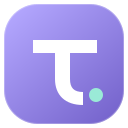
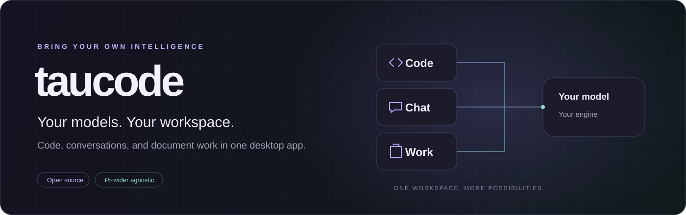
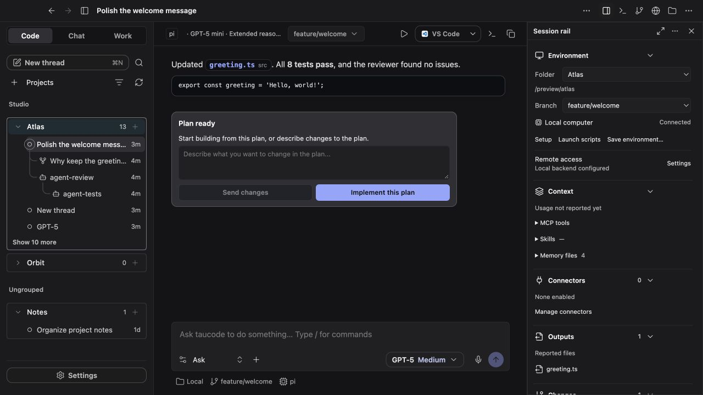
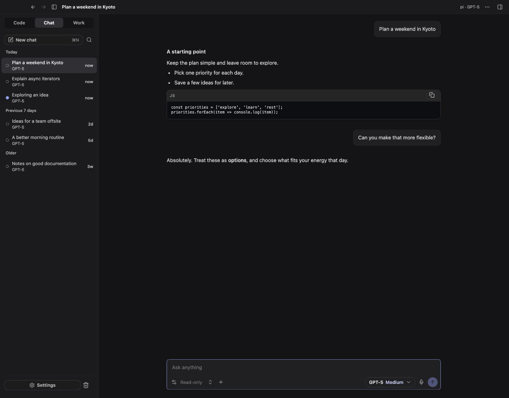
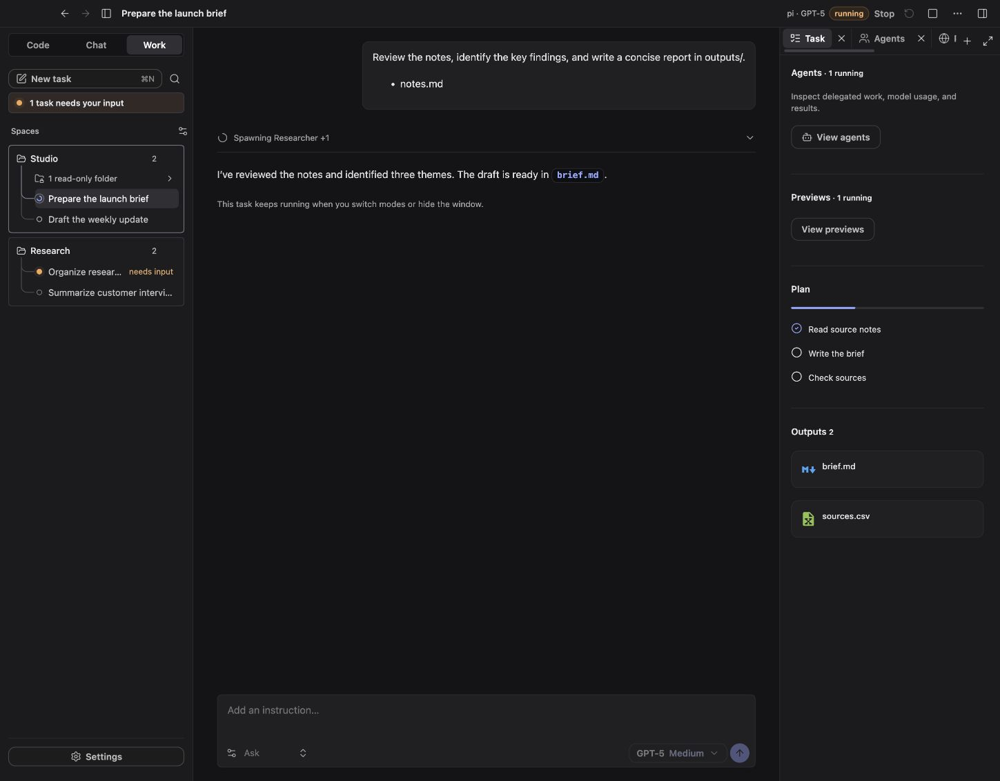

<div align="center">
  

# taucode

**Your models. Your workspace.**

A desktop app for AI coding, conversations, and document work.<br>
Bring your own API keys or local models, then choose the engine that runs them.

[](https://aiden0rchad.github.io/taucode/)
[](https://github.com/aiden0rchad/taucode/actions/workflows/docs.yml)
[](https://github.com/aiden0rchad/taucode/actions/workflows/windows.yml)
[](LICENSE)
[](docs/releases.md)

[Documentation](https://aiden0rchad.github.io/taucode/) · [Getting started](docs/getting-started.md) · [Builds & limitations](docs/releases.md) · [FAQ](docs/faq.md) · [Report a problem](https://github.com/aiden0rchad/taucode/issues/new/choose)
</div>



taucode puts the model, agent engine, and workspace under your control. Use a cloud API, a local model server, or your own compatible gateway. Keep project conversations, file changes, terminal sessions, browser tasks, and agent activity together instead of moving between separate tools.

It builds on [CodexMonitor](https://github.com/Dimillian/CodexMonitor), with a provider registry, multiple engines, dedicated Chat and Work modes, bounded agent teams, checkpoints, browser and computer tools, and a customizable desktop interface.

> **Early development:** macOS has the broadest live verification. Windows has an unsigned x64 test installer and build/startup checks; Linux and iOS need further validation. There is no stable release guarantee or feature parity across platforms. Read the [current status](docs/releases.md) before installing.



*The actual interface rendered by the offline UI preview with sample projects and messages. Screenshots do not show private workspaces or live provider sessions.*

## Three ways to work

| Mode | Use it for | What you get |
| --- | --- | --- |
| **[Code](docs/code.md)** | Working in a project or repository | Project conversations, model and engine selection, diffs, Git/worktrees, terminals, side chats, agents, and checkpoints. |
| **[Chat](docs/chat.md)** | Asking questions and discussing attached material | A separate conversation history, streaming replies, text/image attachments, Markdown export, and an optional restricted Web toggle. |
| **[Work](docs/work.md)** | Turning a folder and a brief into deliverables | Spaces, queued tasks, plans, approvals, output files, and bundled document, spreadsheet, presentation, PDF, and chart skills. |

Code uses the selected enabled engine. Chat and Work use dedicated pi profiles; changing the Code engine does not change those profiles.

<details>
<summary><strong>See Chat and Work</strong></summary>

### Chat



### Work



*Both screenshots use the offline preview's sample data.*

</details>

## Get started

The complete [installation and first-run guide](docs/getting-started.md) covers prerequisites, platform differences, provider setup, and the first task.

### Run from source

You'll need **Node.js 22.19 or newer with npm**, the **stable Rust toolchain**, **Git**, **CMake**, and your platform's [Tauri prerequisites](https://v2.tauri.app/start/prerequisites/). Native dependencies require additional platform tools; Windows needs MSVC and LLVM/Clang, and macOS computer-use components need Xcode/Swift tooling.

```sh
git clone https://github.com/aiden0rchad/taucode.git
cd taucode/apps/taucode
npm ci
CARGO_NET_OFFLINE=false cargo fetch --locked --manifest-path src-tauri/Cargo.toml
npm run tauri:dev
```

The native app's Cargo configuration defaults to offline builds. The explicit network override above populates the dependency cache on a fresh checkout.

**Windows:** use `npm run tauri:dev:win` for the platform configuration. An **unsigned, experimental Windows x64 installer** is available in the [Windows test release](https://github.com/aiden0rchad/taucode/releases/tag/windows-x64-v0.7.68). Compilation and startup checks are narrower than full feature verification.

**Just exploring the interface?** Run `npm run preview:ui` from `apps/taucode` and open `http://localhost:1421`. This uses sample data and makes no provider requests. It cannot run real tasks or access native desktop features.

### Connect a model

1. Open **Settings → Providers** and add a cloud API or local server.
2. Configure its authentication and choose **Test & fetch models**.
3. Enable a model and choose your defaults under **Settings → Agents**.
4. Check **Settings → Engines** and install the pi runtime if needed.
5. Add a project in **Code**, start a **Chat**, or choose a folder in **Work**.

The setup checklist walks through appearance, provider, engine, project, features, and permissions. Reopen it from **Settings → About → Setup checklist**.

taucode uses provider credentials. It does not connect ChatGPT, Claude, or other consumer subscription accounts. API usage and provider limits apply separately. See [providers and authentication](docs/providers.md).

## What you can do

| Capability | Details |
| --- | --- |
| **Choose providers** | OpenAI, Anthropic, Google, OpenRouter, Groq, Mistral, xAI, DeepSeek, Z.ai, Ollama, LM Studio, and compatible endpoints. Compatibility depends on the model and engine. |
| **Choose engines** | pi by default, oh-my-pi, optional Codex, Claude Code through ACP, and compatible custom ACP/pi-RPC executables. |
| **Work across projects** | Group projects, keep conversation trees, fork side chats, inspect diffs, manage Git branches/worktrees, and use GitHub integrations through `gh`. |
| **Delegate deliberately** | Single model, custom delegation, or Code's Chain of Command, with role/model selection and concurrency, depth, time, and reported-token limits. |
| **Connect tools** | Configure stdio or HTTP MCP servers with per-server approval and tool filters. CodeGraph is an optional code-intelligence integration. |
| **Use the browser** | A native macOS browser pane, a Windows native pane with separate Chromium automation, and an advanced Chromium backend. |
| **Use desktop apps** | Experimental macOS computer use with explicit permissions, app restrictions, approval controls, and Stop/takeover behavior. |
| **Recover and compare** | Checkpoints and selective rewind, interrupted-turn recovery, an opt-in diagnostics journal, and versioned model/engine evaluations. |
| **Make it yours** | Light/dark/system appearance, built-in and custom themes, editable tokens, shape/border choices, and independent feature switches. |

## Documentation

The [documentation site](https://aiden0rchad.github.io/taucode/) has local search, a persistent guide sidebar, light/dark themes, and page outlines. Every guide is also readable directly in this repository.

| Start and configure | Daily use | Reference and development |
| --- | --- | --- |
| [Install & first run](docs/getting-started.md) | [Code](docs/code.md) | [Troubleshooting](docs/troubleshooting.md) |
| [Providers & models](docs/providers.md) | [Chat](docs/chat.md) | [FAQ](docs/faq.md) |
| [Engines & features](docs/engines.md) | [Work](docs/work.md) | [Privacy & storage](docs/privacy.md) |
| [MCP & CodeGraph](docs/connectors.md) | [Agents & teams](docs/agents.md) | [Architecture](docs/architecture.md) |
| [Browser](docs/browser.md) | [Checkpoints & rewind](docs/checkpoints.md) | [Development](docs/development.md) |
| [Computer use](docs/computer-use.md) | [Themes](docs/themes.md) | [Diagnostics](docs/diagnostics.md) |
| [Remote daemon & iOS](docs/remote.md) | [Evals](docs/evals.md) | [Packaging & signing](docs/packaging.md) |

## Before you hand it real work

- **Models receive the context you send.** Provider choice determines where prompts, attachments, tool results, and screenshots are processed. A local app is not automatically an offline system.
- **Review the access policy.** Shell commands, connectors, custom engines, and computer use can have real effects. A trusted custom executable is not confined by an OS sandbox just because it speaks ACP.
- **Keep backups.** Checkpoints have exclusions and size limits. Rewind changes files and can delete files added after a checkpoint. It cannot undo remote actions, sent messages, or changes inside another app.
- **Telemetry and diagnostics are separate.** The frontend currently includes inherited Sentry reporting; the local diagnostics journal is opt-in. See [privacy](docs/privacy.md), including how to disable Sentry in a source build.
- **Treat usage limits as reported usage.** Missing prices stay unknown. Requests already in flight can exceed a reported-token threshold; these controls are not a guaranteed billing cap.

## Development

The app lives in `apps/taucode`; the documentation site has its own package in `docs`.

```sh
# From apps/taucode
npm run typecheck
npm test
npm run build

# From the repository root
npm --prefix docs ci
npm --prefix docs run build
```

See [development](docs/development.md) for Rust checks, the UI preview, documentation authoring, and the source map. The [engineering reference](docs/engineering.md) links the original specifications and verification records separately from the user guides.

## Bugs and contributions

[Report a bug](https://github.com/aiden0rchad/taucode/issues/new/choose) with the platform, build, engine, model/provider type, and steps to reproduce. Remove API keys, personal files, and private workspace details from attachments.

Read [CONTRIBUTING.md](.github/CONTRIBUTING.md) before opening a pull request. Report vulnerabilities privately using [SECURITY.md](.github/SECURITY.md).

## License and credits

[MIT](LICENSE). taucode is derived from [CodexMonitor](https://github.com/Dimillian/CodexMonitor) by Thomas Ricouard; the original copyright and license are preserved. Embedded engines, dependencies, models, and app logos retain their own licenses. See [third-party notices](docs/THIRD_PARTY_NOTICES.md).
